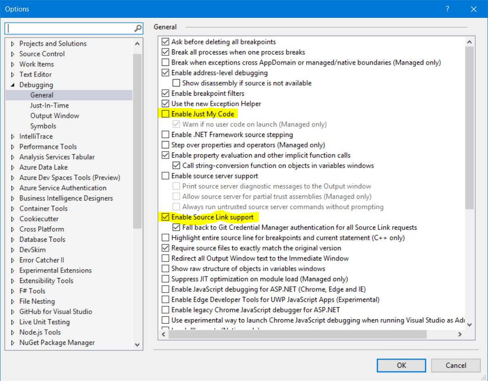

Change Log
===============================================================================

Version 4.0.0 (Unreleased)

- Added .NET 10 support; libraries now target `net10.0` and `netstandard2.0`.
- Upgraded Cronos from 0.8.x to 0.13.0.
- Added deterministic schedule jitter through `SchedulerOptions.CronJitterSeed` and Cronos `H` expressions.
- Added previous-occurrence lookup through `SchedulerTaskWrapper.GetPreviousOccurrence`.
- Migrated tests to xUnit v3 and Microsoft Testing Platform; all tests pass.
- Added tests for `CronJitterSeed` binding/determinism, the missing-seed error path and `GetPreviousOccurrence`; made the scheduler timing tests condition-based instead of fixed sleeps.
- Updated ASP.NET Core, Worker Service, package, sample, migration, and README documentation.
- License expression changed to MIT (#56).
- Added CodeQL code scanning (#52).
- All package versions are centralized in `build/dependencies.props` and bumped to the latest stable.
- Versioning is driven by GitVersion (GitHubFlow) with no hard-coded version.
- Prerelease packages are now published to nuget.org; the separate prerelease feed is retired.
- Breaking: `RunStartupJobsAsync(this IWebHost)` is unavailable on `net10.0`; use `IHost`/`WebApplication`.
- Breaking: `net8.0` target removed (.NET 8 end of support); targets are `net10.0` and `netstandard2.0`.
- All dependencies updated to current supported versions, transitive included; NuGet audit is on.

Version 3.2.0 (07/26/2024)

- removed obsolete methods
- fixed RunStartupJobsAsync

Version 3.1.0 (6/12/2022)

* `SchedulerBuilder.UnobservedTaskExceptionHandler` marked as `Obsolete`;

* Adds a function to create an event handler that handles unobserved task exceptions during the lifetime of the CRON job. Thanks to @stijnmoreels

```csharp
    builder.AddUnobservedTaskExceptionHandler(sp =>
    {
        var logger = sp.GetRequiredService<ILoggerFactory>().CreateLogger("CronJobs");

        return
            (sender, args) =>
            {
                logger?.LogError(args.Exception?.Message);
                args.SetObserved();
            };
    });
```

Version 3.0.1

* Fixed issue with Scheduled jobs that are added on the fly to the execution engine issue #43
* Upgraded to the latest nuget packages

Version 3.0.0

* Removed ScheduledJob class
* Removed properties from IScheduledJob (CronSchedule, CronTimeZone, RunImmediately)
* Simplify registration for the jobs and options.
* Allow for the same job type to be registered with different cron schedule options.
* Jobs options are refreshed if the configuration provider notifies of the changes.

Version 2.1.0

* Introduced the ability to register schedule jobs at any point of time not only at the startup.
* Introduced the `SchedulerOptions` mechanism to update the options on configuration provider reload.

Version 1.1.2

* Resolved issue #22 "schedule executing twice per day instead of once"
* Resolved issue #23 "Updating CronScheduler with .NET Core Workers Template"

Version 1.0.9 (2019-02-18)

* Resolved issue #8 "Add Background Task Queue Functionality".
* Removed `HostedServiceBase` class in favor of built-in `BackgroundService` class.

Version 1.0.7 (2018-01-16)

* Resolved issue #5 "Add support for SourceLink", to make use of this feature in Visual Studio.NET please deselect `Enable Just My Code` and select `Enable Source Link support` as shown per this image:


* Resovled issue #6 "Add support for kdcllc Docker image". 

* Resolved issue #4 "Add support for seconds with Cron".

* Resolved issue #7 "Add support for async Statup.cs job".

```c#
   public string CronTimeZone { get; };

```

Version 1.0.5 (2018-03-12)
----------------------------
 * Resolved issue#1 "Add option to not run job on application start"
 * Resolved issue#2 "Add option to disable job"
 * Add new Extension method that allows adding of the depended jobs:
    ```c#
        services.AddScheduler(builder =>
        {
            // recommended to use TryAddSingleton
            builder.Services.TryAddSingleton<IScheduledJob, TorahQuoteJob>();
            builder.UnobservedTaskExceptionHandler = UnobservedHandler;
        });
    ```
 * Add functional tests.

Version 1.0.4
----------------------------
 * Intial design
